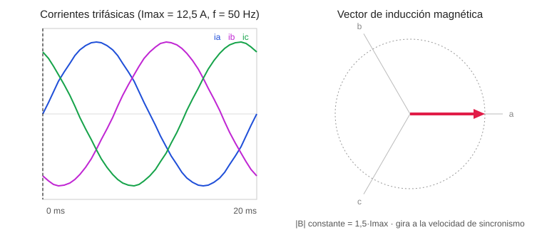

# Portafolio de ingeniería · Carlos

Estudiante del **Grado en Ingeniería Electrónica, Robótica y Mecatrónica** en la Escuela de Ingenierías Industriales de la Universidad de Málaga.

En este repositorio recojo las prácticas y proyectos de la carrera que mejor muestran lo que sé hacer: modelado y simulación de sistemas físicos, programación técnica y diseño electrónico. Cada proyecto tiene su propio README con el objetivo, el planteamiento, los resultados y cómo ejecutarlo.

## Proyectos

| # | Proyecto | Asignatura | Tecnologías | Estado |
|---|---|---|---|---|
| 01 | [Campo magnético giratorio en un sistema trifásico](proyectos/01-campo-magnetico-giratorio/) | Instalaciones y Máquinas Eléctricas | MATLAB · Python | ✅ Entregado |
| 02 | [Sistema de votación electrónica en FPGA](proyectos/02-sistema-votacion-fpga/) | Electrónica Digital | VHDL · Xilinx ISE · Nexys3 | ✅ Entregado |
| 03 | [Control de acceso con máquina de estados (FSM)](proyectos/03-control-acceso-fsm/) | Electrónica Digital | VHDL · FSM Moore · Nexys3 | ✅ Entregado |
| 04 | [Laboratorio de electrónica analógica y circuitos](proyectos/04-laboratorio-electronica-analogica/) | Fundamentos de Electrónica · Teoría de Circuitos | SPICE · WaveForms · instrumentación | ✅ Entregado |

<p align="center"></p>

## Próximos proyectos (curso 2026-27)

Trabajos en curso que se añadirán cuando estén entregados:

| Proyecto | Asignatura | Qué aportará | Fecha |
|---|---|---|---|
| Práctica 1: diseño digital en FPGA y máquina de estados (FSM) | Sistemas Electrónicos | Xilinx ISE, Active-HDL, VHDL/FSM | 13/11/2026 |
| Prácticas de laboratorio (Lab 1517) y trabajo individual | Ingeniería Térmica | Transmisión de calor, análisis experimental | 21-24/12/2026 |
| Trabajo general de grupo | Control por Computador | Control digital, trabajo en equipo, defensa oral | 10/01/2027 |
| Informes de laboratorio: resistividad y tomas de tierra, DGMP | Instalaciones y Máquinas Eléctricas | Medidas eléctricas, normativa de instalaciones | — |

## Competencias

- **Simulación y cálculo:** MATLAB, Python (NumPy, Matplotlib)
- **Electrotecnia:** teoría de circuitos, sistemas trifásicos, máquinas eléctricas, instalaciones de baja tensión
- **Electrónica digital:** VHDL, FPGA (Xilinx ISE, Spartan-6/Nexys3), diseño combinacional y secuencial, máquinas de estados
- **Electrónica analógica:** diodos, transistores BJT, amplificadores operacionales, simulación SPICE, instrumentación (osciloscopio, Analog Discovery)
- **Ingeniería térmica e hidráulica:** volúmenes de control, flujo en conductos, transmisión de calor
- **Control y señal:** control por computador, procesamiento digital de la señal

## Estructura

```
proyectos/
├── 01-campo-magnetico-giratorio/
│   ├── matlab/   código original
│   ├── python/   versión ejecutable sin MATLAB
│   └── media/    animación del resultado
├── 02-sistema-votacion-fpga/
├── 03-control-acceso-fsm/
└── 04-laboratorio-electronica-analogica/
```
