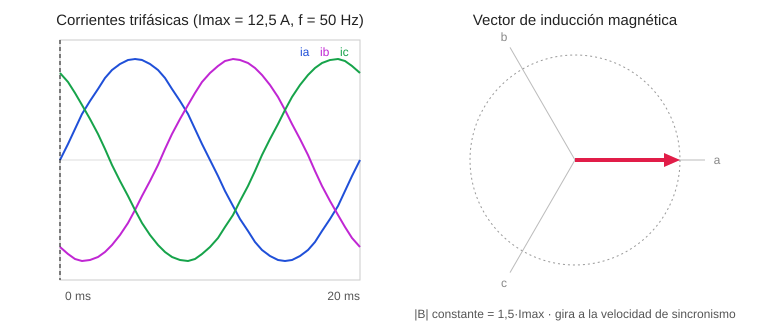

# Campo magnético giratorio en un sistema trifásico

**Asignatura:** Instalaciones y Máquinas Eléctricas · Grado en Ingeniería Electrónica, Robótica y Mecatrónica (UMA), curso 2026-27
**Tema:** Máquina asíncrona · **Herramientas:** MATLAB (Live Script), Python (NumPy, Matplotlib)



## Objetivo

Comprobar numéricamente cómo un sistema trifásico equilibrado de corrientes, aplicado a tres bobinas desfasadas 120º en el espacio, produce un **vector de inducción magnética de módulo constante que gira** a la velocidad de sincronismo. Es el principio de funcionamiento de los motores de inducción y síncronos.

## Planteamiento

Corrientes del sistema (Imax = 12,5 A, f = 50 Hz):

```
ia(t) = Imax · sin(ωt)
ib(t) = Imax · sin(ωt − 2π/3)
ic(t) = Imax · sin(ωt − 4π/3)
```

Cada fase crea un campo en la dirección de su bobina (0º, 120º, 240º). El campo total sale por superposición, sumando las proyecciones de las tres fases en cada instante:

```
Bx = ia·cos(0) + ib·cos(120º) + ic·cos(240º)
By = ia·sin(0) + ib·sin(120º) + ic·sin(240º)
```

El programa recorre un periodo completo, actualiza el vector en cada instante y exporta la animación en GIF.

## Resultados y conclusiones

- **Teorema de Ferraris:** el doble desfase de 120º (espacial entre bobinas y temporal entre corrientes) hace que el vector resultante tenga módulo constante y ángulo variable. Su extremo describe una circunferencia de radio **1,5 · Imax** (18,75 en este caso), y la simulación lo confirma.
- **Velocidad de sincronismo:** el vector gira a la pulsación eléctrica ω. En una máquina de un par de polos da una vuelta por cada ciclo de red.
- **Influencia de la frecuencia:** si aumenta f, el campo gira más rápido; si disminuye, gira más despacio.
- **Secuencia de fases:** al invertirla se invierte el sentido de giro (opción `--inversa` de la versión Python).

## Contenido

| Carpeta | Descripción |
|---|---|
| [`matlab/`](matlab/) | Script original entregado (código del Live Script `simulacion1.mlx`) |
| [`python/`](python/) | Traducción a Python para ejecutarlo sin MATLAB y regenerar el GIF con otros parámetros |
| [`media/`](media/) | Animación del resultado (SVG). El script de Python genera además `CampoMagneticoGiratorio.gif` |

```bash
pip install numpy matplotlib pillow
python python/campo_magnetico_giratorio.py --f 50
```

> El vídeo original de la entrega (`PROYECTO_IME.mp4`, unos 140 MB) no está incluido porque supera el límite de tamaño de GitHub.
