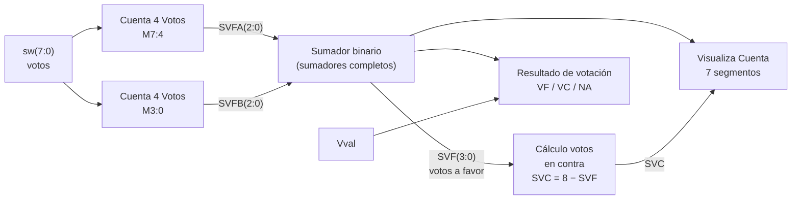
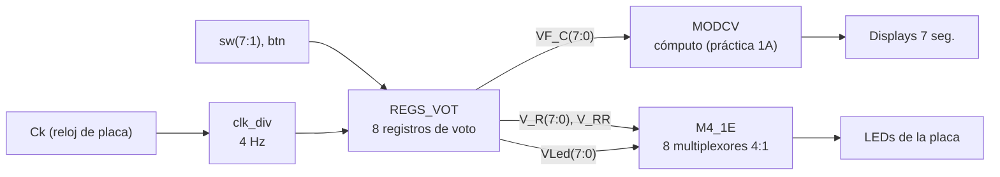

# Sistema de votación electrónica en FPGA

**Asignatura:** Electrónica Digital · Grado en Ingeniería Electrónica, Robótica y Mecatrónica (UMA), curso 2025-26 · Trabajo en pareja
**Herramientas:** Xilinx ISE (esquemáticos y VHDL), ISim, FPGA Spartan-6 en placa Digilent Nexys3, laboratorio remoto

Diseño completo, desde las tablas de verdad hasta la placa, de un sistema digital que gestiona una votación de **8 miembros**: registra el voto de cada elector, hace el recuento y muestra el resultado en LEDs y displays de 7 segmentos. Se desarrolló en tres prácticas que se van integrando:

| Fase | Contenido |
|---|---|
| **1A · Combinacional (esquemático)** | Módulo de cómputo de votos con puertas lógicas y mapas de Karnaugh |
| **1A · VHDL combinacional** | Los mismos bloques descritos en VHDL (sentencias `CASE`) con bancos de prueba |
| **1B · Sistema completo** | Registro secuencial de votos, control de turnos y montaje en la Nexys3 |

## Especificaciones

- **Entradas:** 8 interruptores (uno por elector) y un pulsador de validación `Vval`.
- **Decisión por mayoría cualificada de 7/8:**
  - `VF`, moción aceptada: 7 u 8 votos a favor.
  - `VC`, moción rechazada: entre 1 y 5 votos a favor.
  - `NA`, moción devuelta: no se alcanza una mayoría suficiente para decidir.
- **Visualización:** los displays alternan "F" con el número de votos a favor y "C" con el de votos en contra.

## Arquitectura

Diseño modular top-down, con cada bloque verificado por separado antes de integrarlo:

### Bloques del módulo de cómputo (práctica 1A)

- **Cuenta 4 Votos:** cuenta los unos de 4 bits y obtiene el resultado en binario. Se diseñó con tabla de verdad y mapas de Karnaugh: puertas XOR para el bit de paridad, una red AND/OR para detectar 2 o 3 votos y una AND de 4 entradas para la unanimidad. Partir el contador de 8 votos en dos bloques de 4 simplifica mucho la lógica.
- **Sumador binario:** suma `SVFA + SVFB` (0 a 8) con sumadores completos en cascada (XOR para la suma; AND/OR para el acarreo).
- **Votos en contra:** `SVC = 8 − SVF` en lógica combinacional, con una NOR de 4 entradas que detecta el caso de cero votos a favor.
- **Resultado de votación:** lógica de decisión activada por `Vval` que compara `SVF` con los umbrales de mayoría.
- **Visualiza Cuenta:** convierte `SVF` y `SVC` en el código de los displays y alterna letra y dígito.

### Sistema completo (práctica 1B)

- **Registro individual de voto (`Reg_Vot`):** máquina de estados con dos biestables FDC:
  - `00` espera: el elector todavía no está seleccionado.
  - `01` habilitado: `Led_V` encendido, a la espera de que pulse a favor o en contra.
  - `11` voto realizado: se activa `V_R` y el voto queda **bloqueado por realimentación** hasta el `CLR` general.
- **Generador de habilitación:** exclusión mutua para que solo vote un elector a la vez.
- **Fin de votación (`V_RR`):** una AND de 8 entradas detecta que han votado todos.
- **Matriz de multiplexación:** elige qué ven los LEDs: progreso, participación o resultado.

El registro de voto se implementó de **tres formas**: esquemático, VHDL con `CASE` y VHDL con ecuaciones de excitación (`Reg_Vot_Exc`). Las simulaciones confirmaron que las tres son **equivalentes bit a bit**.

## Verificación

- Simulación funcional en **ISim** de cada bloque, con bancos de prueba que recorren las 16 combinaciones de entrada de cada módulo de 4 bits (pasos de 50 ns).
- Generación del `top.bit` y prueba en la placa (laboratorio remoto) de los tres casos posibles: aceptada (`VF`), rechazada (`VC`) y devuelta (`NA`).
- Demostración presencial del sistema completo en la Nexys3.

## Qué aprendí

- Diseño jerárquico y verificación bloque a bloque: dividir el problema hizo mucho más fácil localizar y corregir fallos.
- Equivalencia entre esquemático, VHDL de comportamiento (`CASE`) y VHDL estructural (ecuaciones).
- Flujo completo en FPGA: diseño, simulación, síntesis, generación del bitstream y prueba en hardware.

> Las memorias originales (PDF con esquemáticos, cronogramas de simulación y fotos de la placa) no se publican en el repositorio.
