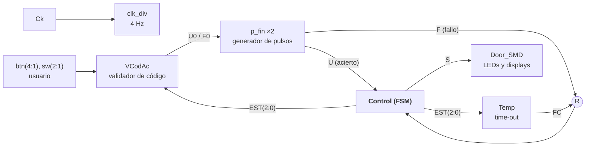
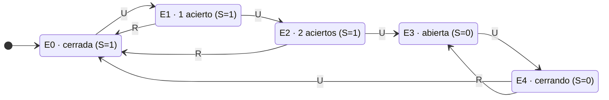

# Control de acceso con máquina de estados en FPGA

**Asignatura:** Electrónica Digital · Grado en Ingeniería Electrónica, Robótica y Mecatrónica (UMA), curso 2025-26 · Trabajo en pareja
**Herramientas:** Xilinx ISE, VHDL, ISim, placa Digilent Nexys3

Diseño del **módulo central de control** de una puerta de seguridad que se abre con un código secuencial de botones. El control es una **máquina de estados finitos (FSM) síncrona de tipo Moore**: se diseñó a mano (diagrama, tabla de transiciones y Karnaugh), se describió en VHDL y se probó en la placa.

## Sistema global

- **VCodAc:** comprueba en tiempo real si el botón pulsado es el correcto para el usuario y el paso de la secuencia.
- **p_fin:** convierte la pulsación (de duración variable) en un pulso limpio de un ciclo de reloj.
- **Temp:** temporizador de time-out que evita esperas indefinidas entre pulsaciones.
- **Door_SMD:** muestra la puerta abriéndose y cerrándose en los LEDs y los displays.

## Especificación de la FSM

- **Apertura:** con la puerta cerrada (`S = 1`), hacen falta **tres pulsos `U` seguidos**. Un pulso `R` (fallo o time-out) aborta y vuelve al reposo.
- **Cierre:** con la puerta abierta (`S = 0`), hacen falta **dos pulsos `U` seguidos**. Un `R` cancela el cierre y la puerta sigue abierta.
- **Prioridad de seguridad:** si llegan a la vez `U` y fin de cuenta, gana `R`.

**Implementación:** 5 estados necesitan **3 biestables D** (2³ = 8 ≥ 5), con codificación binaria consecutiva para reducir la lógica. La salida es de tipo Moore y se queda en una sola variable, **`S = q2'`**. Las ecuaciones de excitación (D2, D1, D0) salen de los mapas de Karnaugh como sumas de productos mínimas. La línea `CL` va al clear asíncrono de los biestables para volver siempre a `E0` de forma segura.

## Implementación en VHDL

- **`Control_Exc`:** descripción estructural. Las ecuaciones de Karnaugh se asignan de forma concurrente a las entradas D, y un proceso síncrono sensible a `Ck` y `CL` actualiza el estado en cada flanco de subida.
- **Modificación del validador:** como tarea adicional, se cambió en `VCodAc.vhd` la secuencia de cierre del usuario 1 para que fuera `btn(2)` seguido de `btn(4)`.

## Verificación

- **Banco de pruebas** con secuencias de apertura y cierre correctas y casos de fallo y time-out.
- **Síntesis** y generación del `.bit` para la Nexys3. En la placa se cumplieron todas las especificaciones: puerta cerrada, apertura, puerta abierta y cierre.

## Qué aprendí

- Proceso completo de diseño de una FSM síncrona: especificación, diagrama, tabla, codificación, Karnaugh, esquemático y VHDL.
- Integrar un módulo propio en un sistema con varios bloques y respetar sus interfaces.
- Diseñar pensando en la seguridad: prioridad de las señales de aborto y reset asíncrono a un estado seguro.

> La memoria original (PDF con tabla de transiciones, esquemático, simulaciones y fotos de la placa) no se publica en el repositorio.
