# Automatización de una estación de carga de rodamientos con PLC (TwinCAT 3)

**Asignatura:** Automatización Industrial · Grado en Ingeniería Electrónica, Robótica y Mecatrónica (UMA), curso 2025-26 · Grupo de 3
**Equipo de laboratorio:** estación **FMS-202** de la célula de fabricación flexible del laboratorio
**Tecnologías:** Beckhoff **TwinCAT 3** · IEC 61131-3 (**SFC/GRAFCET** + **Texto Estructurado**) · **EtherCAT** (EK1200, EL1008, EL2008, EL3061) · visualización HMI de TwinCAT · guía GEMMA

Programa completo de PLC que gobierna una estación real: toma rodamientos de un almacén, **mide su grosor con un palpador analógico**, rechaza los que no corresponden al tipo pedido y **carga los válidos en un palé** que llega por una cinta transportadora. El programa incluye:

- Modos **manual, ciclo a ciclo, por lotes y continuo**.
- **Parada a fin de ciclo** y **pausa de emergencia** sin perder el estado.
- **Restauración automática** a la posición inicial.
- Gestión de **falta de material** (rodamientos o palé).
- **HMI** desde la que se manejan todas las entradas y salidas.

| Lo que demuestra este proyecto | Dónde verlo |
|---|---|
| Diseño de automatismos secuenciales con GRAFCET y estructura GEMMA | [GRAFCET uno por uno](#grafcet-uno-por-uno) |
| Arquitectura jerárquica y modular, con un protocolo de sincronización entre bloques | [Arquitectura del software](#arquitectura-del-software) |
| Programación en Texto Estructurado: métodos, detección de flancos, temporizadores | [`codigo/FB_Estacion.st`](codigo/FB_Estacion.st) |
| Configuración de E/S sobre bus de campo EtherCAT y mapeo de variables | [Hardware y E/S](#hardware-y-mapa-de-entradas-y-salidas) |
| Tratamiento de señal analógica para medir y clasificar piezas | [Tarea Medir](#tarea-medir-medición-y-clasificación) |
| Gestión de fallos, seguridad y señalización al operario | [Fallos y seguridad](#gestión-de-fallos-pausa-y-seguridad) |
| Diseño de HMI para operación y depuración | [Visualización HMI](#visualización-hmi) |

---

## Índice

1. [El proceso](#el-proceso)
2. [Hardware y mapa de entradas y salidas](#hardware-y-mapa-de-entradas-y-salidas)
3. [Arquitectura del software](#arquitectura-del-software)
4. [Modos de funcionamiento](#modos-de-funcionamiento)
5. [GRAFCET uno por uno](#grafcet-uno-por-uno)
6. [Gestión de fallos, pausa y seguridad](#gestión-de-fallos-pausa-y-seguridad)
7. [Señalización del panel](#señalización-del-panel)
8. [Visualización HMI](#visualización-hmi)
9. [Parámetros configurables](#parámetros-configurables)
10. [Revisión técnica y mejoras para una versión 2](#revisión-técnica-y-mejoras-para-una-versión-2)
11. [Contenido de la carpeta y cómo abrir el proyecto](#contenido-de-la-carpeta-y-cómo-abrir-el-proyecto)

---

## El proceso

La estación tiene cuatro subsistemas neumáticos y eléctricos, que el programa coordina en paralelo:

| Subsistema | Actuadores | Sensores | Función |
|---|---|---|---|
| **Alimentador** | Cilindro alimentador | Alimentador delante, presencia de rodamiento | Saca un rodamiento del almacén por gravedad |
| **Cargador** | Cilindro de 3 posiciones (avanza/retrocede) y pinza (abre) | Detrás, medio, delante | Recoge el rodamiento y lo lleva al puesto de medida |
| **Medidor** | Palpador (sube/baja), centrador, rechazador | Arriba, abajo, **valor analógico** | Mide el grosor y expulsa las piezas no válidas |
| **Descargador** | Brazo (avanza, baja, pinza abre) y elevador del palé | Delante/detrás, arriba/abajo | Coloca el rodamiento aceptado en el palé |
| **Carro / cinta** | Motor de la cinta y retenedor | Presencia de palé, código del palé (3 bits) | Trae el palé, lo retiene durante la carga y lo evacúa |

**Ciclo de producción de una pieza:**

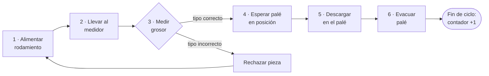

El operario elige en el HMI el tipo de rodamiento (**ANCHAS** o **ESTRECHAS**) y el número de piezas del lote. Mientras se alimenta y se mide, la cinta va trayendo el palé en paralelo, para no perder tiempo de ciclo.

---

## Hardware y mapa de entradas y salidas

### Arquitectura de control

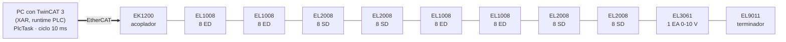

- **Runtime:** TwinCAT 3 (versión 3.1.4024) sobre PC. Una tarea cíclica `PlcTask` llama a `MAIN` cada **10 ms**, con prioridad 20.
- **Bus de campo:** EtherCAT con acoplador **EK1200**, 4 tarjetas de **entradas digitales EL1008**, 4 de **salidas digitales EL2008** y una **entrada analógica EL3061**.
- **Direccionamiento:** todas las variables de E/S se declaran con `AT %I*` / `AT %Q*` (dirección automática) y se vinculan a cada canal en el *System Manager* de TwinCAT. Así el código no depende de direcciones físicas.
- **Total:** **20 entradas digitales, 1 entrada analógica y 21 salidas digitales**, es decir, **42 vínculos de E/S**.

### Mapa de E/S

<details open><summary><b>Entradas</b> (21)</summary>

| Variable PLC | Terminal | Canal | Significado |
|---|---|---|---|
| `i_PulsadorEmergencia` | Term 2 · EL1008 | 1 | Seta de emergencia |
| `i_SelectorManual` | Term 2 · EL1008 | 2 | Selector manual/automático |
| `i_PulsadorMarcha` | Term 2 · EL1008 | 3 | Pulsador de marcha |
| `i_PulsadorParada` | Term 2 · EL1008 | 4 | Pulsador de parada (contacto NC) |
| `i_EstacionConectada` | Term 2 · EL1008 | 5 | Estación alimentada y conectada |
| `i_PresenciaPale` | Term 2 · EL1008 | 6 | Palé en el puesto de carga |
| `i_CodigoPaleBit0` | Term 2 · EL1008 | 7 | Código del palé, bit 0 |
| `i_CodigoPaleBit1` | Term 2 · EL1008 | 8 | Código del palé, bit 1 |
| `i_CodigoPaleBit2` | Term 3 · EL1008 | 1 | Código del palé, bit 2 |
| `i_AlimentadorDelante` | Term 6 · EL1008 | 1 | Alimentador extendido |
| `i_CargadorDetras` | Term 6 · EL1008 | 2 | Cargador en posición trasera |
| `i_CargadorMedio` | Term 6 · EL1008 | 3 | Cargador en posición media (reposo) |
| `i_CargadorDelante` | Term 6 · EL1008 | 4 | Cargador en posición delantera |
| `i_MedidorAbajo` | Term 6 · EL1008 | 5 | Palpador abajo (reposo) |
| `i_MedidorArriba` | Term 6 · EL1008 | 6 | Palpador arriba |
| `i_DescargadorArriba` | Term 6 · EL1008 | 7 | Brazo descargador arriba |
| `i_DescargadorAbajo` | Term 6 · EL1008 | 8 | Brazo descargador abajo |
| `i_DescargadorDetras` | Term 7 · EL1008 | 1 | Descargador atrás |
| `i_DescargadorDelante` | Term 7 · EL1008 | 2 | Descargador delante |
| `i_PresenciaRodamiento` | Term 7 · EL1008 | 3 | Hay rodamiento en el alimentador |
| `i_MedidorValor` (INT) | Term 10 · **EL3061** | AI | Lectura analógica del palpador |

</details>

<details open><summary><b>Salidas</b> (21)</summary>

| Variable PLC | Terminal | Canal | Significado |
|---|---|---|---|
| `o_DesconectaEstacion` | Term 4 · EL2008 | 1 | Desconexión de la estación |
| `o_LamparaAlarma` | Term 4 · EL2008 | 2 | Piloto de alarma |
| `o_LamparaMarcha` | Term 4 · EL2008 | 3 | Piloto de marcha |
| `o_LamparaMaterial` | Term 4 · EL2008 | 4 | Piloto de falta de material |
| `o_CintaActiva` | Term 4 · EL2008 | 5 | Motor de la cinta |
| `o_CintaInvierte` | Term 4 · EL2008 | 6 | Inversión de la cinta (solo en manual) |
| `o_RetenedorBaja` | Term 4 · EL2008 | 7 | Baja el retenedor y libera el palé |
| `o_SeparadorSube` | Term 4 · EL2008 | 8 | Separador (averiado en el laboratorio, no se usa) |
| `o_AvisadorSonoro` | Term 5 · EL2008 | 1 | Zumbador |
| `o_AlimentadorAvanza` | Term 8 · EL2008 | 1 | Avance del alimentador |
| `o_CargadorAvanza` | Term 8 · EL2008 | 2 | Avance del cargador |
| `o_CargadorRetrocede` | Term 8 · EL2008 | 3 | Retroceso del cargador |
| `o_CargadorAbre` | Term 8 · EL2008 | 4 | Apertura de la pinza del cargador |
| `o_MedidorSube` | Term 8 · EL2008 | 5 | Sube el palpador |
| `o_MedidorBaja` | Term 8 · EL2008 | 6 | Baja el palpador |
| `o_RechazadorAvanza` | Term 8 · EL2008 | 7 | Expulsa la pieza rechazada |
| `o_CentradorBaja` | Term 8 · EL2008 | 8 | Centrador de la pieza |
| `o_DescargadorBaja` | Term 9 · EL2008 | 1 | Baja el brazo descargador |
| `o_DescargadorAvanza` | Term 9 · EL2008 | 2 | Avance del descargador |
| `o_DescargadorAbre` | Term 9 · EL2008 | 3 | Apertura de la pinza del descargador |
| `o_ElevadorSube` | Term 9 · EL2008 | 4 | Sube el elevador del palé |

</details>

---

## Arquitectura del software

### Jerarquía

El programa sigue una arquitectura **por niveles**, inspirada en la guía **GEMMA**. Cada nivel solo habla con el inmediatamente inferior:

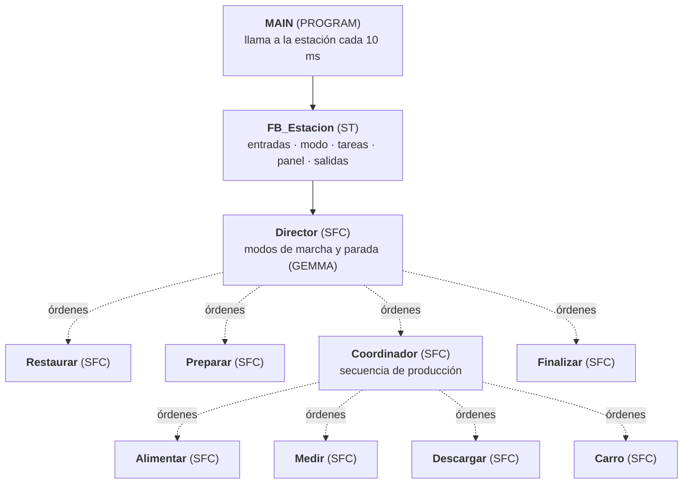

| Nivel | Bloques | Responsabilidad |
|---|---|---|
| **Estación** | `FB_Estacion` | Único punto de lectura de entradas y de escritura de salidas. Decide el modo y gestiona el panel |
| **Dirección** | `FB_EstacionDirector_SFC` | Estados GEMMA: reposo, restauración, preparación, producción, finalización y parada a fin de ciclo |
| **Coordinación** | `FB_EstacionCoordinador_SFC` | Ordena las tareas de un ciclo y reacciona a sus resultados (aceptado, rechazado, falta de material) |
| **Procedimientos** | `Restaurar`, `Preparar`, `Finalizar` | Llevar a la condición inicial y avisar del arranque y del fin de lote |
| **Tareas** | `Alimentar`, `Medir`, `Descargar`, `Carro` | Secuencias de movimientos de cada subsistema físico |

### Protocolo de sincronización `Execute / Ready / Done / Ack`

Todos los GRAFCET usan la **misma interfaz** de *handshake*. Así cualquier bloque se puede orquestar igual:

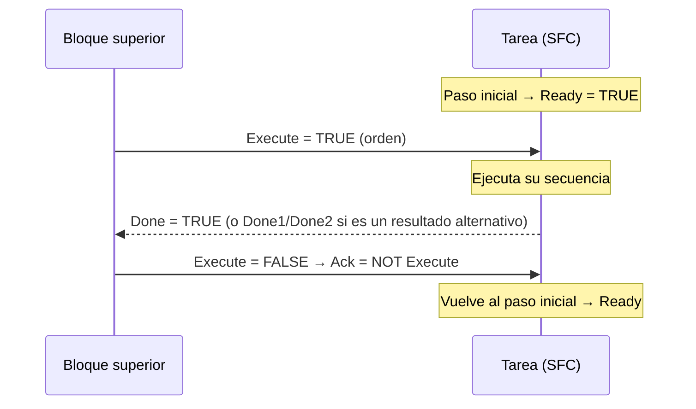

- `Execute`: orden de arranque desde el nivel superior.
- `Ready`: la tarea está en su paso inicial, en reposo.
- `Done`, `Done1`, `Done2`…: **resultados distintos** de una misma tarea. Por ejemplo, `Medir.Done` es "pieza aceptada" y `Medir.Done1` es "pieza rechazada".
- `Ack`: confirmación del nivel superior. Casi siempre es `NOT Execute`, así la tarea solo vuelve a reposo cuando el padre ha visto el resultado y retirado la orden.
- `SFCReset` / `SFCPause`: *flags* implícitos de los SFC de TwinCAT que se cablean desde la estación para **reiniciar** o **congelar** las secuencias a la vez.

Cada `Ready` de la jerarquía se combina en `SistemaEnReposo`. Esa señal solo es verdadera cuando todas las secuencias están en su paso inicial.

### Ciclo de `FB_Estacion` (Texto Estructurado)

`FB_Estacion` se divide en **5 métodos privados**, que se ejecutan en este orden en cada ciclo de 10 ms:

```pascal
m_GestorEntradas();          // 1. Acondicionamiento de señales
m_GestorModo();              // 2. Decisiones de nivel superior (Director)
IF ModoAutomatico THEN
    m_GestorTareas();        // 3. Ejecución de todos los GRAFCET
    m_GestorPanel();         // 4. Pilotos y zumbador
    m_GestorAcciones();      // 5. Escritura de las salidas físicas
END_IF;
```

1. **`m_GestorEntradas`.** Detecta **flancos de subida** (`R_TRIG`) de los pulsadores. La parada usa un contacto NC, así que se detecta el flanco de `NOT i_PulsadorParada`. Une las órdenes del panel físico con las del HMI (`marchavisus`, `stopvisus`, `Emergenciavisus`), calcula la `CondicionInicial` (estación conectada, cargador en medio y palpador abajo) y escala la lectura analógica a milímetros para mostrarla.
2. **`m_GestorModo`.**
   - Calcula si hay **demanda de producción**, según el modo por lotes o continuo, las maniobras pendientes y el tipo de pieza.
   - Si la estación está en condición inicial y se pulsa marcha, pide **producción**. Si no lo está, pide **restauración**.
   - Ejecuta el Director.
3. **`m_GestorTareas`.** Ejecuta el Coordinador, los tres procedimientos y las cuatro tareas, pasándoles las entradas físicas y los tiempos. Calcula `SistemaEnReposo` y `ContinuacionAutorizada`, que sirve para pausar tras cada ciclo.
4. **`m_GestorPanel`.** Calcula los pilotos de marcha, alarma y material, y el zumbador. Para la intermitencia usa el bloque `FB_Blink`.
5. **`m_GestorAcciones`.** Es el **único sitio donde se escriben las salidas**. Cada salida física es la **OR de las peticiones** de los GRAFCET que la usan. Por ejemplo, `o_CargadorAvanza` puede pedirlo `Alimentar` o `Restaurar`. Además, los movimientos se **bloquean con `NOT OrdenPausa`**.

> **Por qué así:** los GRAFCET no tocan nunca las salidas físicas, solo activan variables internas. Así se evita la "doble bobina" (dos secuencias escribiendo la misma salida), el código es más fácil de probar y la pausa de emergencia se aplica en un solo punto.

---

## Modos de funcionamiento

| Modo | Cómo se activa | Comportamiento |
|---|---|---|
| **Manual** | Selector físico `i_SelectorManual` | Solo se ejecuta el acondicionamiento de entradas y el Director; las secuencias automáticas no corren. Cada salida se acciona directamente desde el HMI, que sirve para puesta en marcha y depuración |
| **Automático por lotes** | `ProduccionPorLotes = TRUE` ("Modo Ciclo" en el HMI) | Al entrar en preparación se cargan las **maniobras solicitadas** en el contador de pendientes. Cada ciclo completado lo decrementa. Con 0 pendientes, el Director pasa a **Finalización** y vuelve a reposo |
| **Automático continuo** | `ProduccionPorLotes = FALSE` ("Modo Continuo" en el HMI) | Produce sin límite hasta que se pide la parada |
| **Ciclo a ciclo** | Parámetro `PausaTrasCiclo = TRUE` de `FB_Estacion` (no está en el HMI) | Tras cada ciclo, el Coordinador espera un nuevo **Marcha** para continuar (`ContinuacionAutorizada`) |
| **Parada a fin de ciclo** | Pulsador de parada o *stop* del HMI | El Director pasa a `ParadaSolicitada` y deja **terminar el ciclo en curso**. La pieza no se queda a medias. Las maniobras pendientes se **conservan** para reanudar el lote |
| **Restauración** | Marcha sin estar en condición inicial | El Director lanza `Restaurar`, que lleva el cargador a la posición media y el palpador abajo antes de permitir producir |
| **Pausa de emergencia** | Seta física o botón del HMI | Congela las secuencias (`SFCPause`) y bloquea los movimientos (ver [seguridad](#gestión-de-fallos-pausa-y-seguridad)) |
| **Reinicio** | Botón "Reinicio" del HMI (`ReiniciaEstado`) | `SFCReset` en todos los GRAFCET: vuelven a su paso inicial |

---

## GRAFCET uno por uno

Notación de los diagramas: la caja doble es el **paso inicial**, las cajas son **pasos** con sus acciones y el texto de cada flecha es la **transición**. Todas las acciones son de tipo `N`: la salida está activa mientras el paso lo está. La exportación literal de cada SFC está en [`codigo/GRAFCET_SFC.md`](codigo/GRAFCET_SFC.md).

### Director: estados GEMMA

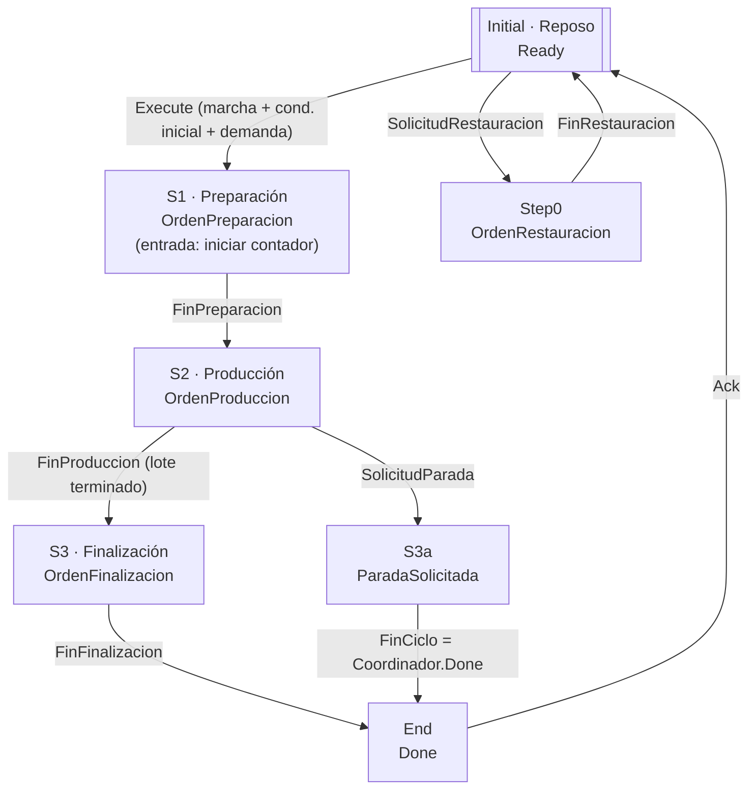

- Desde **reposo** hay dos salidas excluyentes: si la máquina está en condición inicial, se arranca la producción. Si no lo está, primero se **restaura**.
- La acción de entrada de **S1** (`a_ManiobrasPendientes_Iniciar`) carga `ManiobrasSolicitadas` en `ManiobrasPendientes` **solo si el contador está a 0**. Por eso, tras una parada a mitad de lote, se reanuda donde se quedó.
- En **Producción** compiten el fin del lote y la petición de parada. La parada no corta en seco: espera a `FinCiclo`, que es el `Done` del Coordinador al terminar el ciclo en curso.

### Coordinador: secuencia de producción

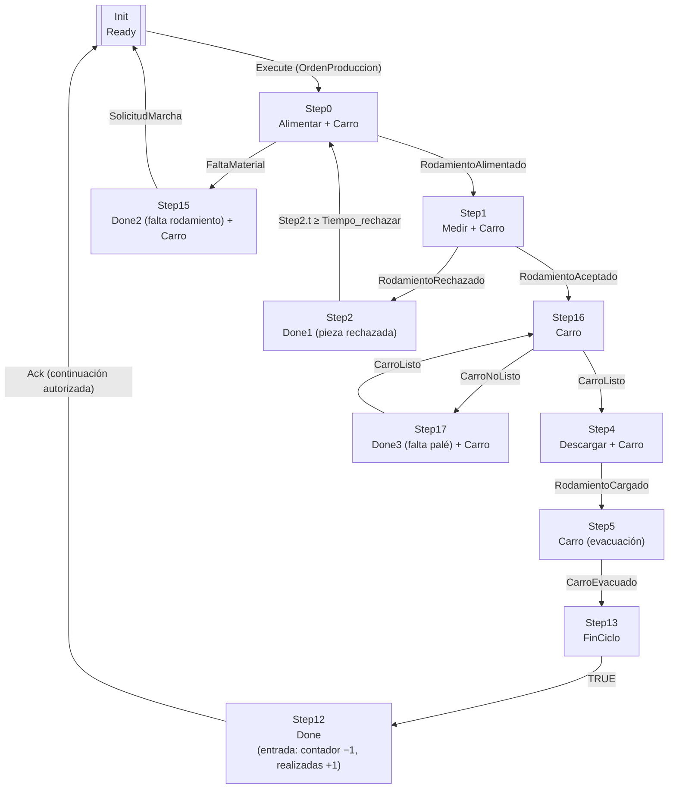

- **Paralelismo:** la orden `Carro` está activa en casi todos los pasos. Por eso la tarea de la cinta trae e identifica el palé **mientras** se alimenta y se mide el rodamiento. Cuando la pieza está aceptada, normalmente el palé ya espera, y el ciclo se acorta.
- **Pieza rechazada:** se espera `Tiempo_rechazar` para que el rechazador termine y se **reintenta** con la siguiente pieza, sin contar el ciclo.
- **Fin de ciclo:** al llegar a `Step12`, el Coordinador da `Done`, que el Director recibe como `FinCiclo` para completar la parada a fin de ciclo. Antes, `Step13` activa la salida `FinCiclo` del propio Coordinador. La acción de entrada de `Step12` (`a_ManiobrasPendientes_Calcular`) suma una realizada y resta una pendiente.
- **`Ack = ContinuacionAutorizada`:** en modo ciclo a ciclo, el GRAFCET se queda en `Done` hasta un nuevo Marcha.

### Tarea Alimentar

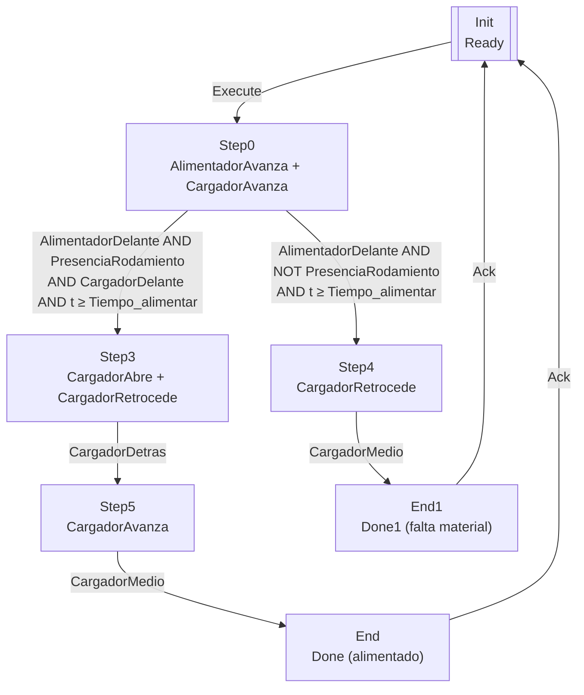

El alimentador empuja el rodamiento mientras el cargador avanza a recogerlo. La transición exige que se cumplan **los sensores y un tiempo mínimo** (`Tiempo_alimentar`), para dar margen a la caída de la pieza. Si al acabar el tiempo **no hay rodamiento**, la tarea devuelve el cargador a reposo y termina con `Done1`, la señal de **falta de material**.

### Tarea Medir: medición y clasificación

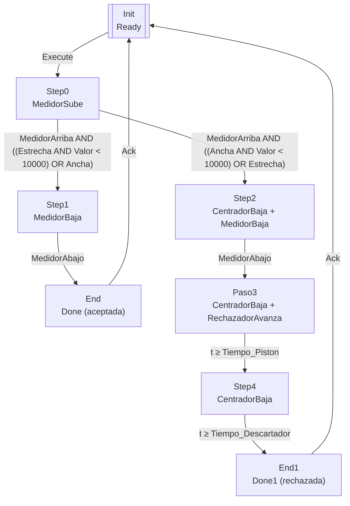

- La lectura del palpador llega por la **EL3061** como `INT` (`i_MedidorValor`). El umbral de clasificación es **10 000 cuentas**, que en la escala del HMI (`Medidormm = valor / 1000`) son **10 mm**.
- Si la pieza es del tipo pedido, el palpador vuelve abajo y la tarea termina en `Done`. Si no, se **centra** la pieza, se acciona el **rechazador** durante `Tiempo_Piston` y se espera `Tiempo_Descartador` antes de terminar en `Done1`.

### Tarea Carro: cinta y palé

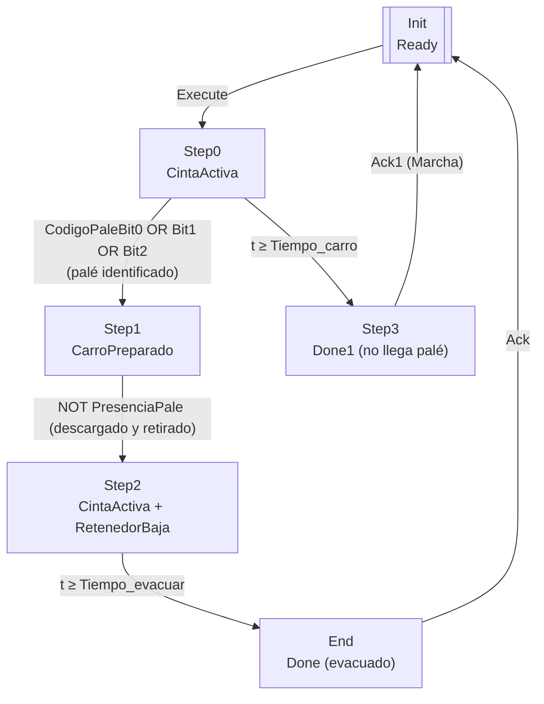

La cinta avanza hasta que se lee un **código de palé** distinto de 0. Si en `Tiempo_carro` no llega ninguno, se da aviso de **falta de palé**. Con el palé en posición, se publica `CarroPreparado`, que es la condición que espera el Coordinador para descargar. Tras la carga, se baja el retenedor y la cinta evacúa el palé durante `Tiempo_evacuar`.

### Tarea Descargar

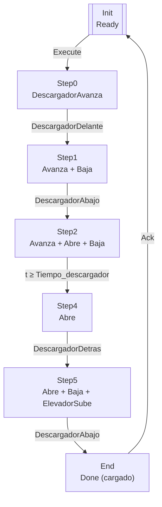

Es una secuencia *pick and place* de 5 pasos. Cada movimiento se confirma con su **final de carrera**, y solo el tiempo de soltar la pieza (`Tiempo_descargador`) es temporizado.

### Procedimientos: Restaurar, Preparar y Finalizar

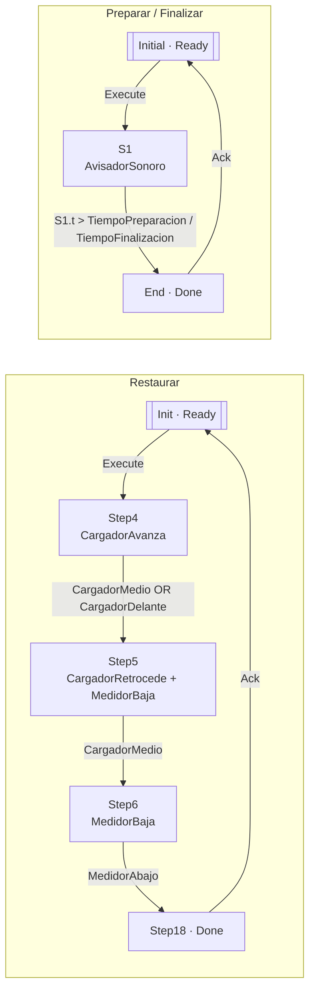

- **Restaurar** lleva la máquina a la **condición inicial** desde cualquier posición del cargador: primero hacia delante, luego hacia atrás hasta la posición media, y baja el palpador.
- **Preparar** y **Finalizar** hacen sonar el **avisador** durante 3 s y 1 s, para avisar de que la máquina va a moverse o de que el lote ha terminado.

---

## Gestión de fallos, pausa y seguridad

| Situación | Detección | Reacción del programa | Señal al operario | Cómo se recupera |
|---|---|---|---|---|
| **Falta de rodamientos** | Alimentador delante sin `PresenciaRodamiento` tras `Tiempo_alimentar` | `Alimentar.Done1` → Coordinador a `Step15` y cargador a reposo | Piloto de **material** intermitente y zumbador | Reponer piezas y pulsar **Marcha** |
| **Falta de palé** | Ningún código de palé en `Tiempo_carro` | `Carro.Done1` → Coordinador a `Step17`, en espera | Piloto de **material** intermitente y zumbador | Colocar el palé y pulsar **Marcha**: la cinta vuelve a buscarlo |
| **Pieza de otro tipo** | Medida analógica fuera del rango pedido | Centrado y expulsión con el rechazador, reintento | Zumbador intermitente | Automática, sin contar la maniobra |
| **Máquina fuera de posición** | `CondicionInicial` falsa al pulsar marcha | Director → `Restaurar` | Piloto de **alarma** intermitente | Automática |
| **Emergencia** | Seta física o botón del HMI | `OrdenPausa`: **SFCPause** congela el Coordinador, los procedimientos y las tareas, y se bloquean cinta, cargador y medidor | Máquina detenida en su posición | Soltar la emergencia: continúa en el **mismo paso** |
| **Parada** | Pulsador NC (flanco) o HMI | Termina el ciclo en curso y vuelve a reposo conservando el lote | Indicador **Parada solicitada** en el HMI | **Marcha** |

**Pausa y reinicio:**
- `OrdenPausa := NOT ReiniciaEstado AND PausaEstado`. Si a la vez se pide reiniciar, **el reinicio tiene prioridad** sobre la pausa.
- La pausa **conserva el estado** de todas las secuencias, así que al soltar la emergencia la máquina sigue exactamente donde estaba.
- Si se prefiere empezar de cero, `ReiniciaEstado` hace **SFCReset** de toda la jerarquía.

---

## Señalización del panel

| Salida | Lógica | Significado |
|---|---|---|
| **Piloto de marcha** | Fijo en producción e **intermitente** en espera | Máquina produciendo o esperando una orden |
| **Piloto de alarma** | Intermitente si está en reposo sin poder arrancar o mientras restaura | Hace falta intervención o la máquina se está colocando en posición inicial |
| **Piloto de material** | Intermitente con falta de rodamiento o de palé | Reponer material |
| **Zumbador** | Fijo en finalización e **intermitente** en preparación, rechazo o falta de material | Aviso acústico de arranque, fin de lote o incidencia |

La intermitencia la genera `FB_Blink`, un oscilador configurable (`TimeOn`/`TimeOff`, 500 ms por defecto) hecho con un `TON` y un `R_TRIG`.

---

## Visualización HMI

El proyecto incluye una **visualización de TwinCAT** organizada por zonas:

- **PLANTA:** un elemento por cada actuador y sensor de la estación: cinta, retenedor, presencia y código del palé, alimentador, cargador, medidor, rechazador, centrador, descargador y elevador. Los actuadores son **botones de conmutación** sobre las salidas, así que **en modo manual se puede mover cualquier actuador**. Los sensores se muestran como **indicadores**. La **altura del palpador** se ve en milímetros.
- **TAREA:** selección de piezas **ANCHAS / ESTRECHAS** y contadores de maniobras **Solicitadas** (editable), **Pendientes** y **Realizadas**.
- **Panel:** **Inicio**, **stop**, **Reinicio** y **PULSADOR EMERGENCIA** virtuales; selector **Modo Continuo / Modo Ciclo** (por lotes); pilotos de alarma, material, avisador, manual y parada solicitada.

Las órdenes del HMI se suman a las del panel físico en `m_GestorEntradas`, así que la máquina se puede manejar igual desde las dos.

---

## Parámetros configurables

Todos los tiempos son entradas de `FB_Estacion` con un valor por defecto. Se pueden ajustar sin tocar las secuencias:

| Parámetro | Valor | Uso |
|---|---|---|
| `Tiempo_alimentar` | 2 s | Tiempo mínimo de empuje del alimentador |
| `Tiempo_rechazar` | 1 s | Espera tras rechazar una pieza |
| `Tiempo_Piston` | 0,5 s | Duración del golpe del rechazador |
| `Tiempo_Descartador` | 1 s | Espera tras el rechazo |
| `Tiempo_descargador` | 0,5 s | Tiempo para soltar la pieza en el palé |
| `Tiempo_carro` | 3 s | Tiempo máximo de espera del palé (alarma de falta de palé) |
| `Tiempo_evacuar` | 2 s | Tiempo de cinta para evacuar el palé |
| `TiempoPreparacion` | 3 s | Aviso sonoro antes de arrancar |
| `TiempoFinalizacion` | 1 s | Aviso sonoro de fin de lote |
| `ManiobrasSolicitadas` | 1 (HMI) | Tamaño del lote |

---

## Revisión técnica y mejoras para una versión 2

Al repasar el código para documentarlo he encontrado varias mejoras posibles:

1. **Prioridad en la clasificación de piezas anchas.** En la divergencia de `Medir`, la rama de aceptación tiene `... OR Ancha`, así que **con ANCHAS seleccionado se acepta cualquier pieza**. Como gana la rama de la izquierda, la de rechazo no llega a evaluarse. La condición simétrica correcta es:
   `MedidorArriba AND ((Estrecha AND MedidorValor < 10000) OR (Ancha AND MedidorValor >= 10000))`.
2. **Tipo de pieza en modo continuo.** En `DemandaProduccion`, el `AND` tiene precedencia sobre el `OR`, así que en modo continuo se puede arrancar **sin elegir ancho**. En ese caso `Medir` se quedaría esperando en `Step0`. Conviene exigir `(Ancha OR Estrecha)` en los dos modos.
3. **Exclusión mutua Ancha/Estrecha** en el HMI, con dos botones de radio en lugar de dos interruptores.
4. **Umbral como parámetro.** Sacar el `10000` a una constante o entrada (`UmbralGrosor`), con la conversión a mm documentada.
5. **Diagnóstico de time-outs** en los movimientos con final de carrera. Si un cilindro no llega a su sensor, ahora la secuencia espera indefinidamente.

---

## Contenido de la carpeta y cómo abrir el proyecto

```
05-automatizacion-plc-twincat/
├── README.md               ← este documento
└── codigo/
    ├── MAIN.st             programa principal
    ├── FB_Estacion.st      bloque de la estación: declaración de E/S, cuerpo y los 5 métodos
    ├── FB_Blink.st         generador de intermitencia
    └── GRAFCET_SFC.md      exportación literal de los 9 SFC (pasos, acciones, transiciones) y sus acciones ST
```

Los SFC de TwinCAT se guardan como XML gráfico. Por eso están exportados en `GRAFCET_SFC.md`, para leerlos en texto sin necesidad de TwinCAT.

**Proyecto original:** solución `AIM_TC3_G07.sln` (TwinCAT XAE 3.1.4024) con el PLC `PLC_CLR`: 1 programa, 11 bloques funcionales (2 en ST y 9 en SFC), 1 tarea y 1 visualización. Para abrirlo: *TwinCAT XAE → File → Open → Open Solution from Archive* y elegir el archivo `.tnzip`.
