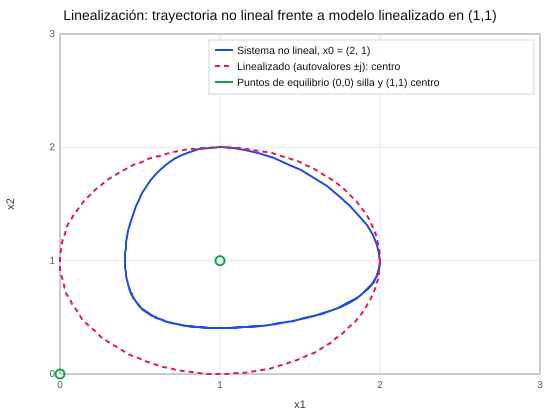
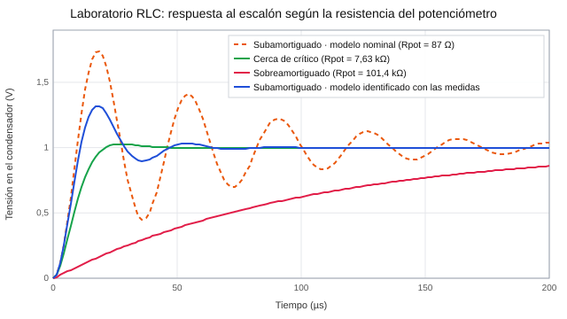
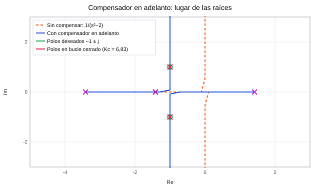
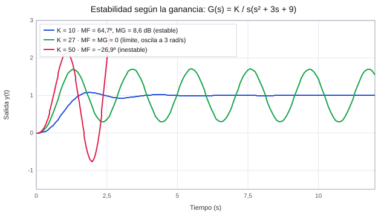
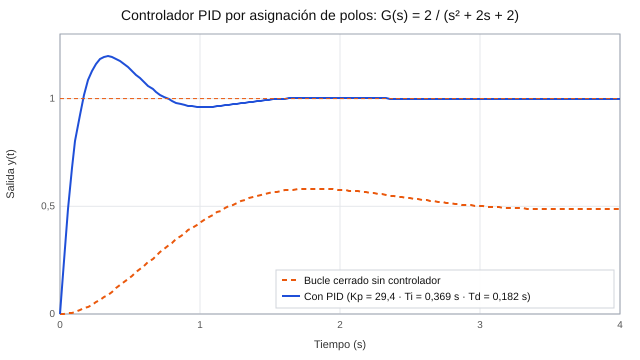

# Fundamentos de Control: modelado, análisis y diseño de controladores en MATLAB

**Asignatura:** Fundamentos de Control · Grado en Ingeniería Electrónica, Robótica y Mecatrónica (UMA), curso 2025-26
**Herramientas:** MATLAB (Control System Toolbox, Symbolic Math Toolbox, `rltool`), osciloscopio y generador de señal en el laboratorio

Conjunto de prácticas en las que recorro el ciclo completo de un ingeniero de control:

1. **Modelado:** espacio de estados, linealización y diagramas de bloques.
2. **Análisis:** respuesta temporal, lugar de las raíces, diagramas de Bode y estabilidad.
3. **Diseño:** control proporcional, compensador en adelanto y controladores PI y PID.
4. **Validación experimental:** dos prácticas de laboratorio con un circuito RLC real, en las que identifico el modelo a partir de medidas de osciloscopio.

| Práctica | Contenido | Código |
|---|---|---|
| 2 · Linealización | Puntos de equilibrio, jacobiano, estabilidad local y simulación no lineal (`ode23`) | [`p02_linealizacion.m`](codigo/p02_linealizacion.m) |
| 3 · Diagramas de bloques | Reducción con `series`, `parallel`, `feedback` y sistemas complejos con `append` + `connect` | [`p03_diagramas_de_bloques.m`](codigo/p03_diagramas_de_bloques.m) |
| 4 · Simulación | Influencia de polos y ceros en la respuesta, entradas escalón, rampa, impulso y arbitrarias (`lsim`) | [`p04_simulacion_de_sistemas.m`](codigo/p04_simulacion_de_sistemas.m) |
| 5 · **Laboratorio RLC (tiempo)** | Respuesta al escalón medida frente a modelo, e identificación del sistema | [`p05_laboratorio_rlc_respuesta_temporal.m`](codigo/p05_laboratorio_rlc_respuesta_temporal.m) |
| 8 · Lugar de las raíces | Reglas de trazado, polos para un rango de K, control proporcional con especificaciones | [`p08_1`](codigo/p08_1_lugar_de_las_raices.m) · [`p08_2`](codigo/p08_2_control_proporcional_ldr.m) |
| 9 · **Compensador en adelanto** | Diseño completo por el lugar de las raíces | [`p09_compensacion_en_adelanto.m`](codigo/p09_compensacion_en_adelanto.m) |
| 10 · Bode | Márgenes de fase y de ganancia, ganancia crítica y estabilidad | [`p10_diagramas_de_bode.m`](codigo/p10_diagramas_de_bode.m) |
| 11 · Laboratorio RLC (frecuencia) | Barrido en frecuencia y Bode experimental frente al modelo | [`p11_laboratorio_rlc_respuesta_frecuencial.m`](codigo/p11_laboratorio_rlc_respuesta_frecuencial.m) |
| 12 · **PI y PID** | Diseño por asignación de polos | [`p12_controladores_pi_pid.m`](codigo/p12_controladores_pi_pid.m) |

Cada archivo `.m` contiene, tarea a tarea, el enunciado resumido como comentario y mi solución.

---

## 1. Linealización de un sistema no lineal

Sistema de dos ecuaciones acopladas: `ẋ1 = −x1 + x1·x2`, `ẋ2 = x2 − x1·x2`.

- **Puntos de equilibrio** (con `solve` simbólico): **(0, 0)** y **(1, 1)**.
- **Jacobiano** con `jacobian` y evaluación en cada punto:
  - En (0,0): `A = [−1 0; 0 1]`, con autovalores −1 y +1. Es un **punto de silla, inestable**.
  - En (1,1): `A = [0 1; −1 0]`, con autovalores ±j. Es un **centro**, marginalmente estable en el modelo lineal.
- **Validación:** simulo el sistema no lineal con `ode23` desde x0 = (2, 1) y lo comparo con el modelo linealizado.

<p align="center"></p>

La trayectoria no lineal es una **órbita cerrada** alrededor de (1,1), como predice el autovalor imaginario puro. Pero su forma se aleja de la circunferencia del modelo lineal a medida que se separa del punto de equilibrio. El modelo linealizado solo es fiable **cerca** del punto donde se linealiza.

En la misma práctica también linealizo un sistema masa con muelle no lineal (`ẍ = u − 2x²`) alrededor de su equilibrio y comparo la simulación lineal (`lsim`) con la no lineal.

---

## 2. Diagramas de bloques

Además de las reducciones básicas, resuelvo **cinco diagramas complejos**, con varios lazos anidados y realimentaciones cruzadas, de forma sistemática con `append` + `connect`:

1. Se numeran los bloques.
2. Se escribe la **matriz de conexiones** `q`. Cada fila indica qué salidas entran a cada bloque y con qué signo.
3. `connect` obtiene el sistema equivalente entre la entrada y la salida elegidas.

```matlab
sysba = append(G0, G1, G2, G3);          % bloques sin conectar
q = [2 1 -4; 3 2 0; 4 3 0];              % bloque 2 ← 1 − 4, bloque 3 ← 2, bloque 4 ← 3
sysb_ss = connect(sysba, q, 1, 3);       % entrada 1 → salida 3
sysb_tf = tf(sysb_ss)
```

Este método evita los errores del álgebra de bloques a mano y se escala sin problema a diagramas de más de diez bloques.

---

## 3. Laboratorio: respuesta temporal de un circuito RLC

Circuito RLC serie montado en placa, con salida en el condensador y un potenciómetro para variar el amortiguamiento:

$$G(s)=\frac{1}{LC\,s^2+(R_{pot}+R_L)\,C\,s+1},\qquad L=33\text{ mH},\; C=1\text{ nF},\; R_L=1\text{ k}\Omega$$

**Procedimiento:**
1. Obtengo la función de transferencia en general y para los extremos del potenciómetro.
2. Expreso ganancia estática, frecuencia natural y amortiguamiento en función de R, L y C: K = 1, ωn = 1/√(LC), ζ = R·C·ωn / 2.
3. Mido con el osciloscopio la respuesta al escalón en las posiciones de subamortiguamiento, amortiguamiento crítico y sobreamortiguamiento.
4. Comparo las medidas con la simulación (`step`).

| Régimen | Rpot medida | Magnitud | Medido | Modelo nominal |
|---|---|---|---|---|
| Subamortiguado | 87 Ω | Tiempo de pico | **18 µs** | 18,1 µs |
| | | Sobreoscilación | **32 %** | 74 % |
| Sobreamortiguado | 101,4 kΩ | Constante de tiempo | **108 µs** | ≈ 102 µs |
| Crítico | 7,63 kΩ | Resistencia para ζ = 1 | **7,63 kΩ** | 10,5 kΩ (R total = 2√(L/C) = 11,5 kΩ) |
| Todos | | Ganancia estática | **1** | 1 |

**Identificación del sistema real.** La frecuencia de oscilación coincide con el modelo, pero el circuito real está **mucho más amortiguado** (32 % frente a 74 % de sobreoscilación). A partir de las dos medidas del régimen subamortiguado:

- ζ = −ln(0,32) / √(π² + ln²0,32) = **0,34**
- ωn = π / (tp·√(1 − ζ²)) = **1,86·10⁵ rad/s**
- Con C = 1 nF: **L ≈ 29 mH** y **R_efectiva ≈ 3,7 kΩ**

Es decir, hay unos 2,6 kΩ de resistencia que el modelo nominal no tiene en cuenta: la resistencia de salida del generador, las pérdidas de la bobina a esta frecuencia y la tolerancia de los componentes. Con el **modelo identificado** la simulación reproduce la medida. Ese es el modelo (L = 29 mH, R ≈ 3,5 kΩ) que uso después en la práctica de respuesta frecuencial.

<p align="center"></p>

---

## 4. Lugar de las raíces y control proporcional

- **Antes de dibujar el lugar**, predigo número de ramas, asíntotas y si cruzará al semiplano derecho, y lo compruebo con `rlocus`.
- Obtengo los polos en bucle cerrado para un **rango de ganancias** (`rlocus(G, K)`).
- Compruebo cuándo dejan de valer las fórmulas de segundo orden: con K = 2, los polos de `(2s+5)/(s²+3s+4)` en bucle cerrado tienen ζ = 0,935 y predicen una sobreoscilación casi nula, pero la respuesta real sobreoscila un 6 % por el cero en −2,5.
- Con `rltool` busco el **rango de K de un controlador proporcional** que cumple a la vez varias especificaciones: tiempo de establecimiento, sobreoscilación, tiempo de pico y error en régimen permanente (ante escalón o ante rampa, según el tipo del sistema), sin salir del rango de K que mantiene el sistema estable según Routh. También identifico qué combinaciones de especificaciones **no se pueden cumplir** con un control proporcional. Ese es el punto de partida para diseñar compensadores.

---

## 5. Diseño de un compensador en adelanto

**Problema:** la planta `G(s) = 1/(s² − 2)` es **inestable**, con un polo en +√2. Se pide que el sistema realimentado tenga **ts = 3 s** (criterio del 5 %) y **tp = π s** ante un escalón.

| Paso | Cálculo | Resultado |
|---|---|---|
| 1. Polos dominantes deseados | σ = 3/ts = 1, ωd = π/tp = 1 | **s₁,₂ = −1 ± j** |
| 2. ¿Basta un controlador P? | `rlocus(G)`: el lugar solo recorre el eje real y el eje imaginario | **No**, los polos deseados no están en el lugar |
| 3. Deficiencia de ángulo | φ = 180º − ∠G(s₁) | **φ = 45º** |
| 4. Cero y polo del compensador | Cero que cancela el polo estable de la planta: zc = −√2; polo que aporta los 45º restantes | **zc = −1,414 · pc = −3,414 · T = 0,707 · α = 0,414** |
| 5. Ganancia | Condición de módulo en s₁ | **Kc = 6,83** |

$$G_c(s)=6{,}83\,\frac{s+1{,}414}{s+3{,}414}$$

**Verificación:** los polos en bucle cerrado quedan exactamente en **−1 ± j**, además de −1,414, que se cancela con el cero. La respuesta al escalón tiene un **tiempo de pico de π s**, como se pedía. El compensador **estabiliza la planta** y desplaza el lugar de las raíces hasta hacerlo pasar por los polos deseados:

<p align="center"></p>

---

## 6. Diagramas de Bode y estabilidad

Calculo con `margin` los **márgenes de fase y de ganancia**, la **ganancia crítica** y compruebo la estabilidad de cada caso con el lugar de las raíces y la respuesta al escalón. Por ejemplo, para `G(s) = K / s(s² + 3s + 9)`:

| K | Margen de fase | Margen de ganancia | Bucle cerrado |
|---|---|---|---|
| 10 | 64,7º | 8,6 dB | **Estable** |
| 27 | 0º | 0 dB | **Límite de estabilidad**: oscilación mantenida a 3 rad/s |
| 50 | −26,9º | −5,4 dB | **Inestable** |

La ganancia crítica K = 27 coincide con la que da el criterio de Routh (3·9 = 27):

<p align="center"></p>

---

## 7. Laboratorio: respuesta frecuencial del circuito RLC

Con el mismo circuito, el procedimiento es el siguiente:

1. Se excita la entrada con una senoide de 1 V entre 1 kHz y 100 kHz.
2. Se mide con el osciloscopio la **ganancia y el desfase** entre la entrada y la salida para cada frecuencia.
3. Con esas medidas se construye el **diagrama de Bode experimental**, del que se leen los márgenes.
4. Se compara con el Bode simulado en MATLAB.

Para la simulación uso un modelo con **L = 29 mH y R ≈ 3,5 kΩ**, coherente con lo que se identificó en la práctica de respuesta temporal. La resonancia del circuito queda en torno a 1/(2π√(LC)) ≈ 30 kHz, dentro del rango barrido.

---

## 8. Controladores PI y PID por asignación de polos

El método consiste en igualar la **ecuación característica** del sistema con controlador a la que forman los polos deseados. Lo resuelvo de forma **simbólica** con `syms`, `numden` y `solve`.

**PI** para `G(s) = 0,1 / (s + 0,0375)` con polos deseados −0,0375 ± 0,0509j:

- s² + (0,0375 + 0,1K)s + 0,1K/T = (s − p₁)(s − p₂)
- **K = 0,375 · T = 9,38 s**

**PID** para `G(s) = 2 / (s² + 2s + 2)` con polos deseados −7,416 y −2,651 ± 3,804j:

- s³ + (2 + 2KpTd)s² + (2 + 2Kp)s + 2Kp/Ti = (s − p₁)(s − p₂)(s − p₃)
- **Kp = 29,4 · Ti = 0,369 s · Td = 0,182 s**

<p align="center"></p>

Sin controlador, el bucle cerrado tiene un **error en régimen permanente del 50 %** y tarda unos 3 s. Con el PID, la acción integral **anula el error**, el sistema se establece en menos de 1 s y los polos en bucle cerrado quedan exactamente en los deseados.

---

## Qué demuestra este proyecto

- **Modelado** de sistemas físicos y no lineales, y criterio para saber cuándo vale un modelo lineal.
- **Análisis** en tiempo y en frecuencia: polos, lugar de las raíces, Bode, márgenes y estabilidad.
- **Diseño de controladores** con especificaciones: proporcional, compensador en adelanto, PI y PID.
- **Trabajo experimental:** medir con osciloscopio, comparar con la simulación y **corregir el modelo** cuando no coincide con la realidad.
- Uso avanzado de MATLAB: Control System Toolbox, cálculo simbólico, `connect`, `ode23`, `lsim` y `rltool`.

> Las figuras de este README se han generado a partir de los diseños de cada práctica.
